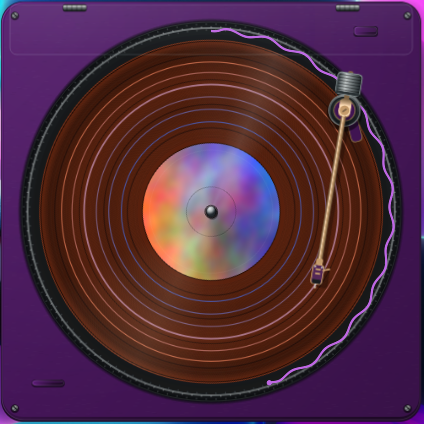

# Spun Widget

A vinyl turntable on your [Hyprland](https://hyprland.org) desktop that shows and controls
whatever music is playing, made for the [Noctalia](https://noctalia.dev) shell.

[Русская версия](README.ru.md)



It is the record player of [Spun](https://github.com/yappologistic/Spun) by yappologistic, cut
down to a desktop widget: a record that spins while music plays, a tonearm you can drag,
a progress ring around the record, and records that swap when the album or video changes.

## Features

- **Follows any MPRIS player** (Firefox, VLC, Spotify, mpv…), preferring the one that plays.
  YouTube's muted hover previews are ignored.
- **The tonearm is the remote**:
  - drag it onto the grooves to seek; hold **Shift** for 10× finer seeking that snaps to chapter starts;
  - click it to pause (it lifts to the rest) or resume (it lands where it stopped);
  - drop it on the lead-in at the record's edge to play from the start;
  - drop it on the label for the next track;
  - drop it off the record to pause: it stays where you left it.
- **The rim of the record** is a seek ring.
- **YouTube chapters** appear as rings on the record, the playing one lit. Chapters of the next
  video are fetched shortly before the current one ends, so its record arrives with its rings.
- **Colours**: the record, the chapter rings and the progress ring can each take the default
  colours, the Noctalia theme or the colours of the track's cover; the player body can follow
  the theme. A grey cover gives a black record.
- Mouse only: the widget never takes the keyboard. English and Russian.

## Requirements

- Hyprland and Noctalia 5.2 or newer (the widget sits in a Noctalia desktop-widget frame)
- Qt 6.8+ (Quick, Quick Controls, DBus, Network, Concurrent, Linguist tools) and LayerShellQt
- Python 3 (for the YouTube chapter helper)

Fedora / Nobara:

    sudo dnf install cmake ninja-build qt6-qtbase-devel qt6-qtdeclarative-devel qt6-qttools-devel layer-shell-qt-devel python3

Arch:

    sudo pacman -S cmake ninja qt6-base qt6-declarative qt6-tools layer-shell-qt python

## Install

    git clone https://github.com/Agent00K0T/spun-widget
    cd spun-widget
    ./scripts/install.sh

This builds the program into `~/.local/bin/spun-widget` (set `PREFIX` for another place) and
copies the Noctalia plugin into `~/.local/share/noctalia/plugins/spun-widget`. Then:

1. Enable the plugin: `noctalia msg plugins enable agent00k0t/spun-widget`
   (or in Noctalia's settings, Plugins).
2. Open Noctalia's desktop widget editor, add **Spun Widget** and place and size its frame.
   The turntable fills that frame and follows it when you move it.
3. Start the player, and add it to Hyprland's autostart:

   ```lua
   -- hyprland.lua
   hl.exec_cmd(os.getenv("HOME") .. "/.local/bin/spun-widget")
   ```

   ```ini
   # hyprland.conf
   exec-once = ~/.local/bin/spun-widget
   ```

4. Optional: **Shift** for the needle. The widget has no keyboard focus, so Hyprland has to tell
   it about Shift. Add [contrib/hyprland-shift.lua](contrib/hyprland-shift.lua) to your
   `hyprland.lua` (Lua configuration only).

The plugin can also come from this repository as a Noctalia plugin source:

    noctalia msg plugins source add spun-widget git https://github.com/Agent00K0T/spun-widget

## Settings

In Noctalia's widget editor, open the settings of the Spun Widget:

| Setting | Values |
|---|---|
| Player color | Default, System colors |
| Record color | Default (black vinyl), System colors, Cover colors |
| Chapter ring color | Default, System colors, Cover colors |
| Progress ring color | Default, System colors, Cover colors |
| YouTube chapters | on / off — when off, the widget never contacts YouTube |
| Only players | parts of player names (`firefox`, `vlc`…, as `playerctl -l` lists them); empty for any |
| Ignored players | players never shown, even when they match Only players |
| Record swap animation | on / off |

Changes apply at once.

## Privacy

For YouTube videos the widget asks YouTube for the video's chapters (one small request per video,
without an account or cookies), and for the next video's chapters near the end of a video.
Turn off **YouTube chapters** and it makes no requests at all.

## How it works

- `src/` — the program: `activeplayer` follows MPRIS players and fetches chapters, `disc` draws
  the record and the progress ring, `playerbody` the deck, `theme` reads Noctalia's colours,
  `main.cpp` places the window on Hyprland's bottom layer inside Noctalia's frame.
- `qml/` — the scene, the tonearm, the chapter rings.
- `scripts/yt-chapters` — chapters from YouTube's own web API (falls back to the watch page).
- `spun-widget/` — the Noctalia plugin: an empty frame plus the widget's settings.
- `i18n/` — translations of the tooltips (`spun-widget_<language>.ts`); the plugin's settings
  are translated in `spun-widget/translations/`.

Testing aid: `SPUN_TEST_CHAPTERS='{"duration":ms,"chapters":[{"start":ms,"title":"…"}]}'`
gives any playing track these chapters.

## License

Spun Widget is a derivative of [Spun](https://github.com/yappologistic/Spun) (commit `d4448ec`)
and, like it, is offered under the [PolyForm Noncommercial License 1.0.0](LICENSE): free to use,
change and share for noncommercial purposes. See [NOTICE](NOTICE).
