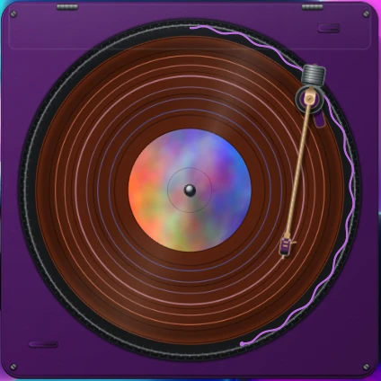

# Spun Widget (Noctalia plugin)

The frame of [Spun Widget](https://github.com/Agent00K0T/spun-widget): a vinyl turntable on the
desktop that shows and controls the playing music (any MPRIS player), with YouTube chapters as
rings on the record.

This plugin is an empty, transparent desktop widget plus the turntable's settings. The turntable
itself is the separate `spun-widget` program from the repository above: install it with
`./scripts/install.sh`, start it with Hyprland, then add **Spun Widget** in the desktop widget
editor and place its frame. The turntable fills the frame and follows it.

Settings: colours of the player, the record, the chapter rings and the progress ring (default,
system or cover colours), YouTube chapters on/off, only some players and ignored players, record swap animation.

License: PolyForm Noncommercial 1.0.0 (a derivative of
[Spun](https://github.com/yappologistic/Spun) by yappologistic).
